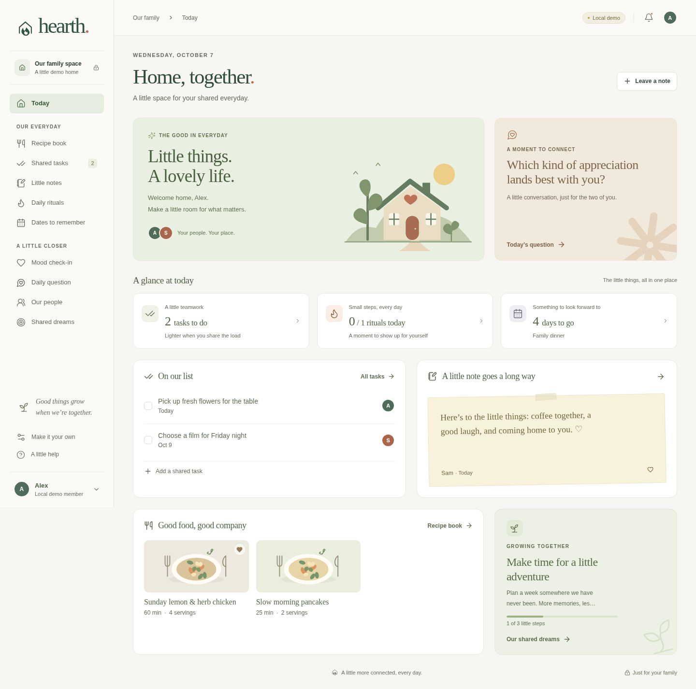

# Hearth

A private, modular home for your family: recipes, shared tasks, daily notes, streaks, countdowns, moods, daily questions, profiles and long-term goals. Built with React, TypeScript, Cloudflare Workers, D1 and Workers AI.

## Local preview

Use Node 22.12+ and npm. Run `npm ci` and `npm run dev`, then open http://localhost:5173 and choose the clearly labeled demo. Demo data lives only in memory and resets when you leave or reload; it is never sent to the API. The production application does not seed fictional family data.

For real local persistence:

1. Run `npm run build` to create Worker assets.
2. Copy `.dev.vars.example` to `.dev.vars`.
3. Run `npm run db:local`.
4. Run `npm run dev:api` in another terminal alongside `npm run dev`.

Local authentication requires `DEV_AUTH=true`, a local request hostname and explicitly configured `FAMILY_MEMBERS`. The first configured member is the default local identity; API tests may select another with `X-Dev-User`. Never configure the development bypass in a deployed Worker.

## Validation

`npm run check` runs TypeScript, unit/API tests, and the production build. `npm run test:e2e` runs browser tests with Chromium (`CHROMIUM_PATH` may override `/usr/bin/chromium`). Production deployment and live AI inference require configured Cloudflare access; passing local tests does not imply either was performed.

The first verified checkpoint passes 259 unit/API/deployment/PWA tests and 42 browser tests, including real local Worker/D1 persistence, accessibility, private-data isolation and offline shell behavior. See the roadmap for later checkpoints. The patched `sharp` override keeps Wrangler's local development image dependency current; reassess the override when Wrangler incorporates that patch.

## Production

See [deployment](docs/DEPLOYMENT.md), [architecture](docs/ARCHITECTURE.md), and [roadmap](docs/ROADMAP.md). The repository deliberately has no credentials or real family identities. Production authentication verifies Cloudflare Access tokens and an explicit family allowlist. Missing configuration fails closed.
